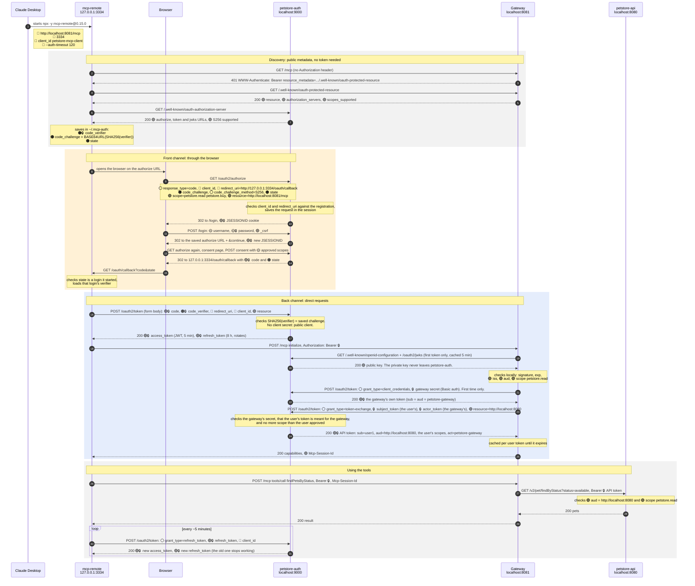

# The OAuth flow, request by request

What happens from the moment Claude Desktop starts `mcp-remote` to the first tool call, in a fresh run (nothing saved
in `~/.mcp-auth`, gateway just started). The same diagram as a coloured web page is in
[`oauth-flow.html`](oauth-flow.html); download it and open it in a browser.

## Key

**Where a value is defined**

| Marker | Defined in |
|---|---|
| 🔵 | Claude Desktop config (`claude_desktop_config.json`) |
| 🟣 | Server config (`application.properties` of petstore-auth or the gateway) |
| 🟠 | Generated by `mcp-remote` at runtime |
| 🟢 | Issued by a server at runtime |
| 🟡 | Typed or chosen by the user |
| ⚪ | Fixed by the OAuth or MCP spec |

**Privacy:** 🔒 marks a secret. Anything without it is public.

**Channels:** the orange band is the **front channel**, the steps that go through the browser. Its URLs end up in
browser history, logs and `Referer` headers, so nothing there may be secret except the one-time code. The blue band is
the **back channel**: direct requests between programs, where the secrets travel in bodies and headers.

## The flow

Step 15, the callback to `127.0.0.1:3334`, isn't visible in mitmweb; only the 302 that causes it is.

## Which server is the token for?

The token names two servers, in two claims:

| Claim | Value | Means |
|---|---|---|
| `iss` | `http://localhost:9000` | Issued by one authorization server, petstore-auth |
| `aud` | `http://localhost:8081/mcp` | Accepted by one resource server, the gateway. Any other service should refuse it. |

The API token from the exchange has the same `iss` but `aud` = `http://localhost:8080`: only the API accepts it.

## Who holds what

● holds it · 🔒 holds it and it's secret · ○ holds only the public half or a hash

| Value | Kind | mcp-remote | Browser | petstore-auth | Gateway | Why it's safe |
|---|---|:-:|:-:|:-:|:-:|---|
| `client_id` | public | ● | ● | ● | | Names the app, not the user |
| `state` | public | ● | ● | ● | | Lets `mcp-remote` reject callbacks it didn't start |
| `code_challenge` | public | ● | ● | ● | | A hash: the verifier can't be worked out from it |
| `code_verifier` | secret | 🔒 | | 🔒 | | Back channel only, used once, then deleted |
| password | secret | | 🔒 | ○ | | Typed only into petstore-auth's own page |
| `JSESSIONID` | secret | | 🔒 | 🔒 | | HttpOnly cookie, renewed at login |
| authorization code | short-lived secret | 🔒 | 🔒 | 🔒 | | Useless without the verifier, single use, 5 minutes |
| access token | secret | 🔒 | | 🔒 | 🔒 | Lasts 5 minutes; `aud` limits it to the gateway |
| refresh token | secret | 🔒 | | 🔒 | | Never sent to the gateway; rotates on every use |
| API token | secret | | | 🔒 | 🔒 | Lasts 5 minutes; also held by the API. Its `aud` is the API, so the gateway can't use it on itself |
| gateway client secret | secret | | | ○ | 🔒 | petstore-auth keeps only a BCrypt hash |
| signing key | secret | | | 🔒 | ○ | The gateway and the API hold only the public half (JWKS) |

## Rules of thumb

- **Front channel: nothing secret.** The only sensitive value is the code, and it's useless without the verifier.
- **Back channel: the secrets.** The verifier and the tokens travel only in direct requests. In production these use
  HTTPS; mitmweb sees them only because it sits in the middle on plain http.
- **The private key never moves.** petstore-auth signs with it; the gateway checks every token locally with the
  public key, without calling back.
