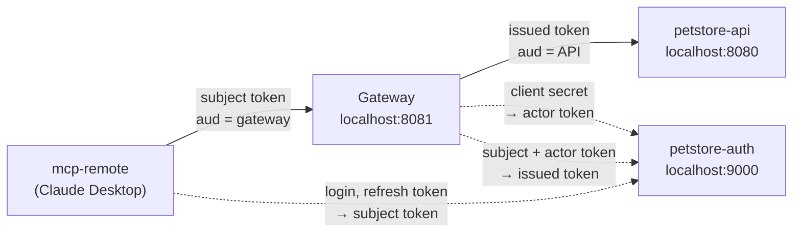
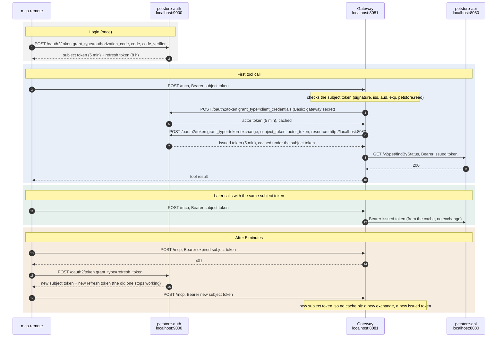

# The tokens, one by one

Four tokens are involved in getting from Claude Desktop to the Petstore API. This page says what each one is, what it
contains, when it's created, who holds it and why it's needed. The same content as a web page with diagrams is
[`tokens.html`](tokens.html); download it and open it in a browser. For the login itself, request by request, see
[`oauth-flow.md`](oauth-flow.md).

Every payload below is real: captured on 2026-10-29 from a running petstore-auth by a script that did what mcp-remote
and the gateway do (log in as `user1`, get the gateway's own token, exchange). The tokens expired five minutes later,
and the key that signed them was discarded when the server stopped.

## At a glance

| | Subject token | Refresh token | Actor token | Issued token |
|---|---|---|---|---|
| **In plain words** | the user's token for the gateway | lets mcp-remote get a new subject token without a login | the gateway's own token, about itself | the user's token for the API |
| **Represents** | user1 | user1's login | the gateway | user1, through the gateway |
| **Grant that creates it** | `authorization_code` (login), later `refresh_token` | issued with the subject token | `client_credentials` | token exchange (RFC 8693) |
| **Requested by** | mcp-remote | mcp-remote | gateway | gateway |
| **Sent to** | gateway, on every `/mcp` request | petstore-auth only | petstore-auth only, inside the exchange | API, on every API call |
| **Audience (`aud`)** | `http://localhost:8081/mcp` | (not a JWT) | `petstore-gateway` | `http://localhost:8080` |
| **Format** | signed JWT | random string (opaque) | signed JWT | signed JWT |
| **Lifetime** | 5 minutes | 8 hours, replaced on every use | 5 minutes | 5 minutes |
| **Kept by** | mcp-remote (`~/.mcp-auth`) | mcp-remote (`~/.mcp-auth`) | gateway memory | gateway memory, cached per subject token |

"Subject", "actor" and "issued" are the RFC 8693 names for the roles in a token exchange. All three are ordinary
access tokens; the name says what part each plays.

## Who sends which token where



Solid lines carry tokens to the servers that use them. Dotted lines are requests to petstore-auth's token endpoint,
`POST http://localhost:9000/oauth2/token`, which is the only place tokens are made.

## When each token is created



The gateway exchanges when a request arrives, before the MCP response starts (`ApiTokenExchangeFilter`), so a refused
exchange is a plain `401` rather than an error halfway through a stream. It renews a cached token 30 seconds before
it expires, so a token can't run out between being handed over and arriving.

## The subject token

**Why it's needed.** The gateway must know who is calling and what they approved. The token proves both without the
gateway ever seeing the password, and its `aud` makes it useless anywhere except the gateway.

**Created** by petstore-auth at the end of the login: Spring's authorization code grant, with `aud` set from the
login's `resource` parameter by `ResourceAudienceConfig`. Recreated every five minutes from the refresh token, and
again after a step-up login.

**Checked** by the gateway on every request (`McpSecurityConfig`): signature against petstore-auth's public key, `iss`
and `aud` from the `spring.security.oauth2.resourceserver.jwt.*` properties, `exp` and `nbf`, and the
`petstore.read` scope.

A JWT is three base64url parts joined by dots: header, payload and signature. This is the real one, wrapped:

```
eyJraWQiOiJlM2I4ZTc3Yi0zMjgzLTRiNDItOGNkOS0zMTEzYTUzYmNlNmEiLCJhbGciOiJSUzI1NiJ9      ← header
.eyJzdWIiOiJ1c2VyMSIsImF1ZCI6Imh0dHA6Ly9sb2NhbGhvc3Q6ODA4MS9tY3AiLCJuYmYiOjE3OTMzMDk2NzYsInNjb3BlIjpbInBldHN0b3Jl
LnJlYWQiXSwiaXNzIjoiaHR0cDovL2xvY2FsaG9zdDo5MDAwIiwiZXhwIjoxNzkzMzA5OTc2LCJpYXQiOjE3OTMzMDk2NzYsImp0aSI6ImIzY2Y0
ZjdiLTViM2YtNGU5Mi1iMWY4LTBlNTdlZjM3Y2QxZiJ9                                         ← payload
.zhA6sYj7Z4D8dVt1Abj4A6JFo0i4EacFQdeZT_UNK6gNQ0mDEqmbzCs1JtnVpX-t5hwx1AtRvdWB37HA_OAb-9TKsPlpG38erTvZwh-Kdhk2iLP
N_OMup2SQs9KG2bNE-GVHY8mbVC2UBUavKEZ6-SELPrTU0bVOIN_S8xxzs3eCSXFVWA7XFIHWxOE3T1SvtHVtlDdItcjEfNexwrXpAOk2HmcfUY
gSJgv2hlmL0scWQ7lRHTW4BmNb1NN67JvOmibZAS3rQOGLyOqhhhvkSbuBLRwooThYus6vf9qdhWga0yaQcwrMIB_ZuX3osBdU4bcNPX4KXsFjP
CdQBP7a9A                                                                            ← signature
```

Header and payload are only encoded, not encrypted: anyone holding the token can read them. The signature is what
can't be forged. Decoded:

```json
{ "kid": "e3b8e77b-3283-4b42-8cd9-3113a53bce6a", "alg": "RS256" }
```
```json
{
  "sub":   "user1",
  "aud":   "http://localhost:8081/mcp",
  "nbf":   1793309676,
  "scope": ["petstore.read"],
  "iss":   "http://localhost:9000",
  "exp":   1793309976,
  "iat":   1793309676,
  "jti":   "b3cf4f7b-5b3f-4e92-b1f8-0e57ef37cd1f"
}
```

`iat` and `nbf` are 21:34:36 UTC, `exp` five minutes later. The token response mcp-remote received around it:

```json
{
  "access_token":  "eyJraWQiOi…",
  "refresh_token": "34Ush9WIjsND4ek6MjSzA_-Cgj5hDvB9aTlUr6MEExv4WYW17q3ZNrx6WdKK…",
  "scope":         "petstore.read",
  "token_type":    "Bearer",
  "expires_in":    299
}
```

## The refresh token

**Why it's needed.** Access tokens last five minutes to limit the damage of a leak. Without a refresh token the user
would log in every five minutes.

**Created** with the subject token. Spring gives refresh tokens only to confidential clients; mcp-remote is public (no
secret), so `PublicClientRefreshTokens` adds them. It **rotates** (`reuse-refresh-tokens=false`): each use returns a
new refresh token and retires the old one. If a copy is stolen, only one of the two holders can keep refreshing:
whichever uses it second gets `invalid_grant`, which shows something is wrong.

**It isn't a JWT.** It's a random 128-character string that means nothing by itself; petstore-auth looks it up in its
own records. It goes only between mcp-remote and petstore-auth: never to the gateway, never to the API.

## The actor token

**Why it's needed.** In the exchange the gateway has to prove two things: that it's the gateway (its client secret
does that) and who is acting for the user. The actor token answers the second, and its `sub` becomes the issued
token's `act` claim. Without an actor token the exchange would be impersonation: the issued token would look exactly
like user1's own, and the API couldn't tell that a program was in between. `TokenExchangeRules` refuses that.

**Created** by `ApiTokenExchange` with `client_credentials`, the first time it's needed and again shortly before it
expires. No user is involved.

**Checked** only by petstore-auth, during the exchange: it must be the requesting client's own token.

```json
{ "kid": "e3b8e77b-3283-4b42-8cd9-3113a53bce6a", "alg": "RS256" }
```
```json
{
  "sub": "petstore-gateway",
  "aud": "petstore-gateway",
  "nbf": 1793309678,
  "iss": "http://localhost:9000",
  "exp": 1793309978,
  "iat": 1793309678,
  "jti": "147e2592-daac-40ab-989d-804a833f9985"
}
```

There's no `scope`: the gateway asks for none. `aud` is Spring's default, the client ID, because the request names no
`resource`. It's never sent to a resource server, so it never needs to be accepted by one.

## The issued token

**Why it's needed.** The API accepts only tokens meant for it, so the subject token (`aud` = the gateway) is refused
there. Passing the user's token on would be *token passthrough*, which the MCP spec forbids. The gateway's own token
won't do either: it has no user in it, and the API needs the user to check what they approved and whose orders
they are.

**Created** by the exchange, which the gateway sends like this (the client secret in the header, the rest in the
form body):

```
POST http://localhost:9000/oauth2/token
Authorization: Basic base64(petstore-gateway:gateway-dev-secret-not-for-production)

grant_type=urn:ietf:params:oauth:grant-type:token-exchange
requested_token_type=urn:ietf:params:oauth:token-type:access_token
subject_token=<subject token>   subject_token_type=urn:ietf:params:oauth:token-type:access_token
actor_token=<actor token>       actor_token_type=urn:ietf:params:oauth:token-type:access_token
resource=http://localhost:8080
```

petstore-auth builds the new token in four places:

| What | Where |
|---|---|
| Finds user1's login record by the subject token; `invalid_grant` if there's none | Spring, `OAuth2TokenExchangeAuthenticationProvider` |
| Copies the scopes user1 approved from that record (the request names none) | Spring, same class |
| Sets `aud` from the request's `resource` | `ResourceAudienceConfig` |
| Requires the actor token to be the gateway's own, the subject token to be meant for the gateway, and no more scope than user1 approved; adds `act` | `TokenExchangeRules` |

**Checked** by the API on every call (`ApiSecurityConfig`): signature, `iss`, `aud` = `http://localhost:8080`,
`exp` and `nbf`, then a scope per endpoint.

```json
{ "kid": "e3b8e77b-3283-4b42-8cd9-3113a53bce6a", "alg": "RS256" }
```
```json
{
  "sub":   "user1",
  "aud":   "http://localhost:8080",
  "nbf":   1793309680,
  "act":   { "sub": "petstore-gateway" },
  "scope": ["petstore.read"],
  "iss":   "http://localhost:9000",
  "exp":   1793309980,
  "iat":   1793309680,
  "jti":   "f4650cab-3c53-45b9-b2d4-4a70ad7302b3"
}
```

The exchange response has no refresh token. When the issued token runs out the gateway simply exchanges again.

```json
{
  "access_token":      "eyJraWQiOi…",
  "issued_token_type": "urn:ietf:params:oauth:token-type:access_token",
  "scope":             "petstore.read",
  "token_type":        "Bearer",
  "expires_in":        299
}
```

## Side by side

| Claim | Subject token | Actor token | Issued token | Meaning |
|---|---|---|---|---|
| `iss` | `http://localhost:9000` | same | same | Who signed it. One authorization server for everything. |
| `sub` | `user1` | `petstore-gateway` | **`user1`** | Who it's about. The exchange keeps the user. |
| `aud` | `http://localhost:8081/mcp` | `petstore-gateway` | **`http://localhost:8080`** | Where it may be used. The one claim that must change. |
| `scope` | `petstore.read` | (none) | **`petstore.read`** | What the user approved. Carried over, never widened. |
| `act` | (none) | (none) | **`{"sub":"petstore-gateway"}`** | Who acts for the user. Delegation, not impersonation. |
| `iat` / `nbf` | 21:34:36 | 21:34:38 | 21:34:40 | When it was issued; not valid before. |
| `exp` | +5 min | +5 min | +5 min | Each token has its own clock. |
| `jti` | `b3cf4f7b-…` | `147e2592-…` | `f4650cab-…` | A unique ID per token: three separate tokens, none edited from another. |
| `kid` (header) | `e3b8e77b-…` | same | same | Which public key checks the signature. |

`aud` is a single string here. A JWT may also carry a list; Spring writes one audience as a string, and the
validators accept either form.

## Claims, in brief

| Claim | Name | Set by |
|---|---|---|
| `iss` | issuer | Spring, from `spring.security.oauth2.authorizationserver.issuer` |
| `sub` | subject | Spring: the user's name, or the client ID for `client_credentials` |
| `aud` | audience | Spring (client ID by default), replaced by `ResourceAudienceConfig` when a resource is named |
| `scope` | scope | Spring, from the approved scopes |
| `act` | actor | `TokenExchangeRules` (RFC 8693 section 4.1) |
| `iat`, `nbf`, `exp` | issued at, not before, expires | Spring, from the client's `access-token-time-to-live` |
| `jti` | JWT ID | Spring, a random UUID |
| `kid`, `alg` | key ID, algorithm (header) | Spring's JWT encoder, from the signing key |

## Scope: what it means and where

A scope is a label. It means something only because a server compares it with a rule:

| Server | Where | `petstore.read` | `petstore.buy` |
|---|---|---|---|
| Gateway | `McpSecurityConfig`, `BuyStepUpFilter` | every `/mcp` request | a `tools/call` of `buyPet` |
| API | `ApiSecurityConfig` | every `GET` under `/v2` | place an order, form update of a pet, delete an order |

Spring turns each scope into an authority named `SCOPE_<scope>` (`petstore.read` becomes `SCOPE_petstore.read`), and
the rules check those authorities.

- **The issued token has the same scope as the subject token** because the scope records what the user approved, and
  that doesn't change when the token moves to another server; only `aud` does. RFC 8693 would allow fewer
  (down-scoping), never more.
- **The scope comes from petstore-auth's record of the login**, not from reading the subject token. That's why the
  exchange stops working when the record is gone (a restart, or a revoked login), even if the subject token still
  looks valid.
- **The consent page shows the raw names.** Spring's default page lists `petstore.read` and `petstore.buy` as
  checkboxes, with no description, and names the app by its client ID, `petstore-mcp-client`.
- **The label can promise less than the rule allows.** `petstore.buy` sounds like "buy a pet", but at the API it also
  allows renaming any pet or changing its status, because `buyPet` is built from three general-purpose calls.
  (Cancelling is limited to the user's own orders, since step 7.) The meaning of a scope is whatever the servers that
  accept it enforce.

## Step-up: what changes

When user1 first tries to buy, the gateway answers `403 insufficient_scope`, the browser asks for `petstore.buy`, and
mcp-remote gets a new subject token. Only the scope differs, plus a new `jti` and new times:

```json
{ "sub": "user1", "aud": "http://localhost:8081/mcp", "scope": ["petstore.read", "petstore.buy"], "…": "…" }
```

The gateway's cache is keyed by the subject token, so the new one gets a new exchange, and the issued token carries
both scopes:

```json
{ "sub": "user1", "aud": "http://localhost:8080", "act": { "sub": "petstore-gateway" },
  "scope": ["petstore.read", "petstore.buy"], "…": "…" }
```

## How a JWT is checked

The gateway and the API check tokens the same way, locally, without asking petstore-auth about each one:

1. Read `kid` from the header and find that key in petstore-auth's public keys,
   `GET http://localhost:9000/oauth2/jwks` (the gateway fetches them on the first token and caches them for five
   minutes).
2. Check the signature with it. A changed claim, or a token signed by anyone else, fails here.
3. `iss` must be `http://localhost:9000`.
4. `exp` and `nbf` must allow now.
5. `aud` must contain this server's own URL.
6. The request must be allowed by the token's scopes.

The private key never leaves petstore-auth. The JWKS holds only the public half:

```json
{ "keys": [ { "kty": "RSA", "e": "AQAB", "kid": "e3b8e77b-3283-4b42-8cd9-3113a53bce6a", "n": "9NqCPC8c6UC6…" } ] }
```

The key is created at startup and kept in memory, so restarting petstore-auth makes every existing token fail step 1.

## When a token is refused

| Situation | Where | Answer |
|---|---|---|
| The subject token is sent to the API | API | `401`: `aud` is the gateway, not the API |
| The issued token is sent to the gateway | Gateway | `401`: `aud` is the API, not the gateway |
| The subject token has expired | Gateway | `401`; mcp-remote gets a new one with the refresh token |
| A refresh token is used a second time | petstore-auth | `invalid_grant`: it was retired by the first use |
| `buyPet` without `petstore.buy` | Gateway | `403 insufficient_scope, scope="petstore.read petstore.buy"` (step-up) |
| petstore-auth was restarted | Gateway | `401`: the signing key is new, and the login record the exchange needs is gone |
| A token meant for another server is exchanged | petstore-auth | `invalid_grant`: the gateway may exchange only tokens meant for itself |
| The exchange asks for more scope than the user approved | petstore-auth | `invalid_scope` |

## Rules of thumb

- **One token, one server.** `aud` decides where a token works. Every hop to a new server gets a new token.
- **Never forward the user's token.** The gateway exchanges it; it doesn't pass it through.
- **The user stays in `sub`; the program in between goes in `act`.** The API knows both who is asking and how.
- **Scope never grows on the way.** More permission means asking the user again (step-up).
- **Short-lived access tokens, rotating refresh tokens.** A leaked access token expires in minutes; a leaked refresh
  token can't be shared quietly, because each use retires it.
